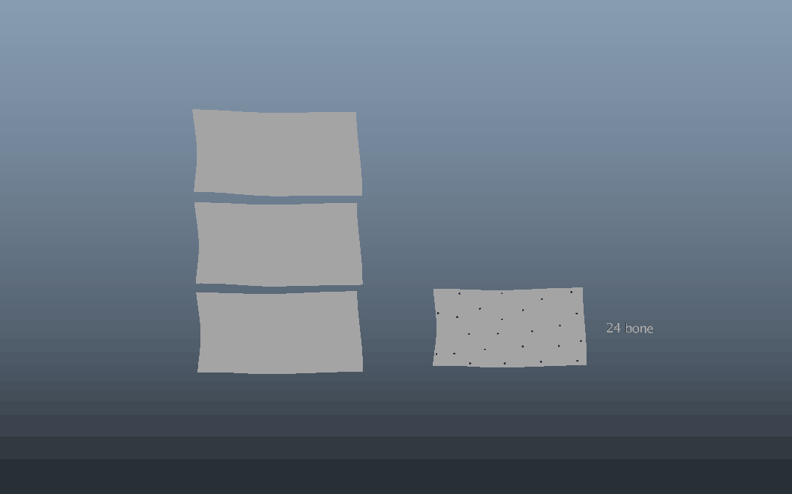
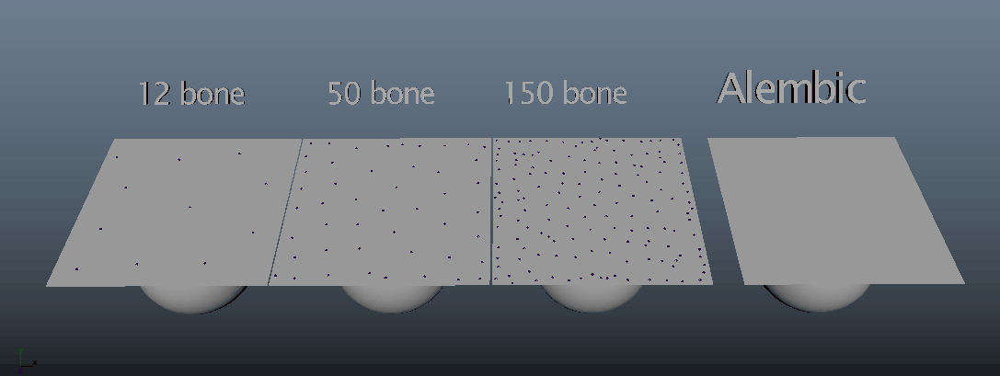

# 🦴 DemBones Maya Plugin

A **Maya plugin** that converts any **mesh or simulation animation** into clean **joint-based animation** using the **DemBones** algorithm — integrated from the open-source project [DemBones by Electronic Arts](https://github.com/electronicarts/dem-bones).

Supports **Maya 2020–2025**

Perfect for converting:
- **Alembic caches**
- **Cloth / fluid simulations**
- **Blendshapes**

…into **optimized skinned animation** ready for **game engines**.

---

## ✨ What's New

The plugin now has **two modes** and several new features since the original release:

| Feature | Description |
|---------|-------------|
| **Shared Skeleton Mode** | Combine multiple simulation clips into a single shared skeleton — ideal for exporting animation clips to a game engine |
| **Auto Bind Pose** | Bind pose is created automatically from the start frame — no manual duplication needed |
| **Custom Root Parent** | Parent the generated skeleton under any existing scene object (joint, group, locator, etc.) |
| **Use Timeline button** | Auto-fill frame range from Maya's current playback range |
| **Duplicate Mesh (static)** | Quick helper to snapshot any animated mesh as a static bind pose |
| **Alembic retime fix** | Correctly handles Alembic caches that have frozen/offset frame timing |

---

## 🔀 Modes

### Single Mode
One simulation mesh → one new skeleton + skin cluster.

The bind pose is **automatically duplicated from the start frame** — just select your sim mesh, set the frame range, and hit **Generate Bones**.

### Shared Skeleton Mode
Multiple simulation meshes (same topology) → one shared skeleton.

Each simulation becomes a **separate animation clip** laid out consecutively on the same rig — ready to export as individual clips to a game engine. All meshes must share the same vertex count as the bind pose target.

---

## ⚙️ Parameters

| Parameter | Description |
|-----------|-------------|
| **Quality** | Global Iterations — controls optimization accuracy. Draft: `20` · Good: `50` · Best: `100+` |
| **Num Bones** | Number of bones to generate. More bones = finer deformation but heavier rig. Typical range: `8`–`64` |
| **Custom Root Parent** | When enabled, the generated root joint is parented under the selected scene object instead of world origin |

Higher bone count captures more detail at the cost of runtime performance. The comparison below shows 12, 50, and 150 bones against the original Alembic:

---

## 🧩 Installation & Uninstallation

| Action | How to Use |
|--------|------------|
| **Install** | Open **Autodesk Maya**, then **drag and drop** `install.py` into the viewport. The plugin, scripts, and icon are copied to your Maya user folder automatically. |
| **Uninstall** | **Drag and drop** `uninstall.py` into the viewport to remove all plugin files and shelf entries. |

---

## 📸 UI Preview

---

Demo: https://www.youtube.com/watch?v=vK1wJo5-Nlo&t=5s
